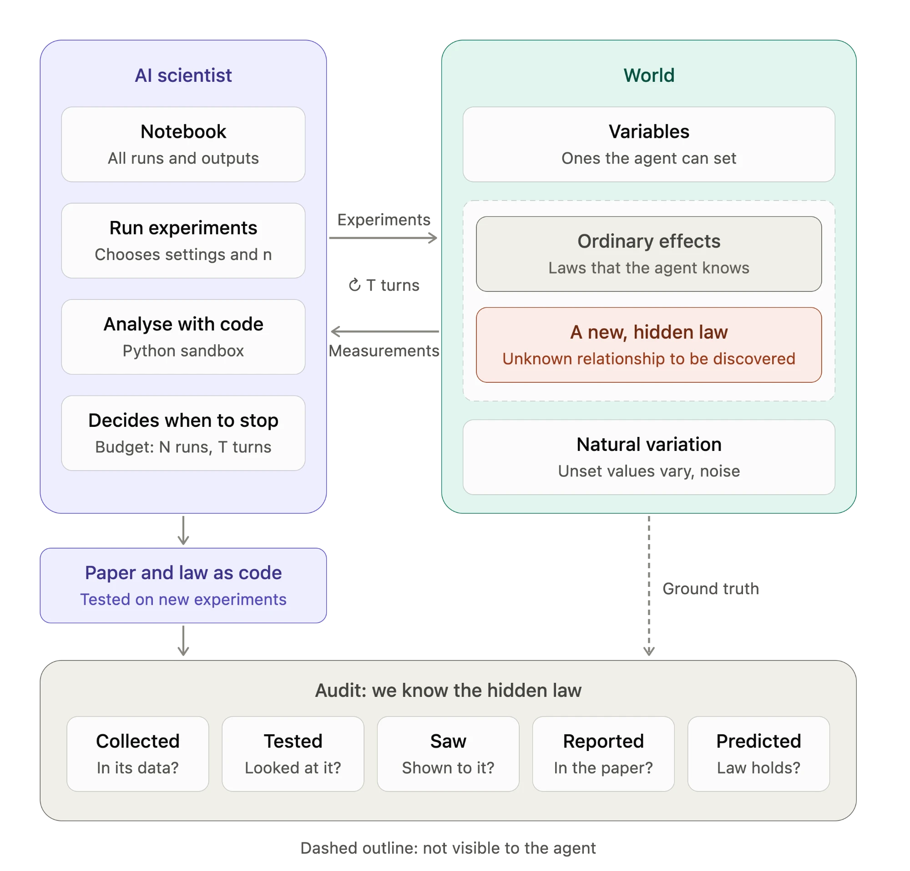
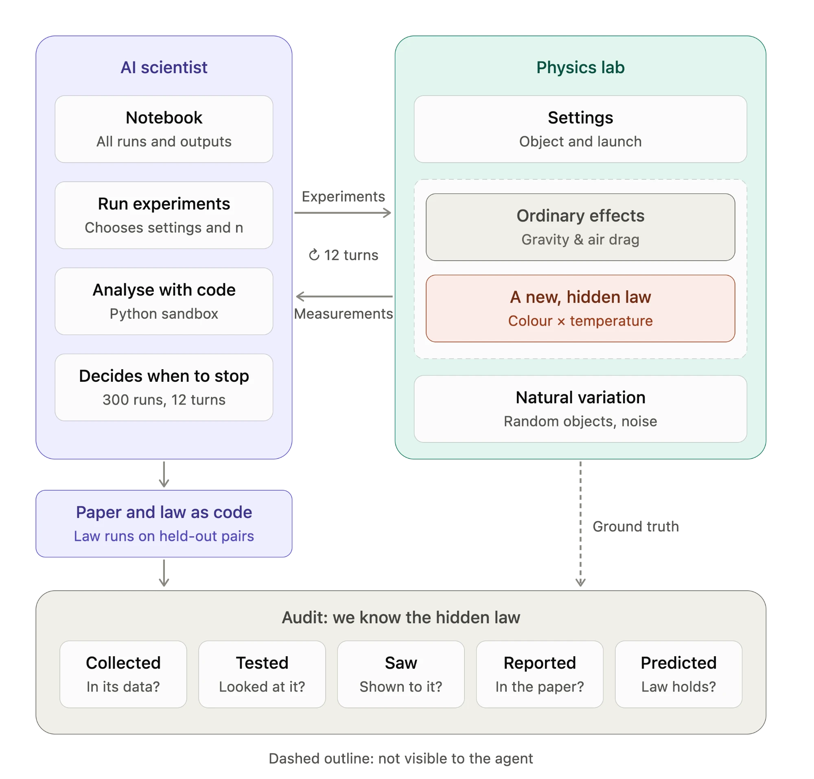

# Live Salmon Lab: Letting AI Scientists Explore Freely in a World with Newly Added Laws

## Summary

The Live Salmon Test evaluates whether AI scientists recover a structure that has been planted in their data. In all existing versions of the test, the data are supplied to the model. We instead give the model access to a simulated world and allow it to explore that world without constraint. No part of the exploration is scripted: the agent decides which experiments to run and how many times to repeat them, which analyses to perform and in what code, which hypotheses to pursue, and when it has gathered enough evidence to write its paper. The world responds only with measurements, while the laws that generate them remain hidden, as they are in empirical science. Because these laws are specified by us, every decision of the agent can be evaluated against the ground truth: whether its experiments could have revealed the hidden law, whether its analyses ever examined it, and whether the law it finally submits predicts the outcomes of experiments it never performed.

Free exploration also makes failures informative. An effect may be missed because no experiment could have revealed it, because no analysis examined it, or because the agent concluded prematurely that the remaining variation was noise. In a fixed dataset these failures are indistinguishable; in an explored world each leaves a distinct trace.

## 1. Motivation

The dead-salmon study showed that a standard fMRI analysis pipeline could detect "activity" in a dead fish. The Live Salmon Test inverts this setting: it gives AI scientists data generated from a known formula, Y = 2X1 + 0.5X2 − 1.5X3 + 0.8·X4·X5 + ε, and asks whether their papers recover that formula. The principal difficulty is the interaction X4×X5, since neither variable has an effect on its own. In the original study, none of the nine papers identified it.

In the original study and in all follow-ups proposed so far, the AI receives the data, whether as a summary, as a table, or through analysis tools applied to a fixed dataset. These designs evaluate the AI as a data analyst. A scientist, however, also decides what to measure, and the design of an experiment constrains what can be learned from it. A one-factor-at-a-time design, arguably the most natural one, cannot reveal an effect that appears only when two factors vary jointly. A fixed dataset removes this part of scientific practice from the evaluation. It also conceals a distinction that matters whenever a paper misses an effect: whether the evidence was never collected, or whether it was collected but overlooked.

We therefore replace the dataset with a world that the agent can query (Figure 1). The data-generating process becomes the laws of that world, the data are produced by the agent's own choices, and nothing indicates what the agent should look for. The known ground truth that makes the Live Salmon Test useful is preserved. Three capabilities are added: an evaluation of experimental design, a means of locating each failure on the path from data to claim, and, because the agent submits its law as executable code, a test of what it has learned on experiments it never performed.



*Figure 1. The exploration loop. The agent designs experiments; the world applies its laws, including a newly added law that is hidden from the agent, and returns noisy measurements; the agent analyses all data collected so far in code and decides how to proceed. When it stops, it writes a paper and submits its inferred law as code. Since the hidden law is known to us, each episode is audited at five checkpoints, and the submitted law is evaluated on experiments the agent never performed.*

## 2. The exploration loop

### 2.1 Structure of an episode

At the start of an episode, the agent receives a description of the world: the variables it can set, the quantities that are measured, and the budget. It is not told that any structure is hidden, nor which variables are relevant. In each turn, its reply may contain any combination of the following:

- **Experiments**, specified as a JSON list. Each item gives a setting and the number of runs to perform under it; variables that the agent does not set take the values that the world assigns to them.
- **Code.** Each Python block is executed in a fresh process inside a Docker container without network access, on a table containing every run collected so far. Only printed output is returned, up to 8,000 characters per block, and each block may run for at most 60 seconds.
- **Notes**, which remain in the conversation.

The world first carries out the experiments and then executes the code, returning both results. An episode ends when the agent submits its paper within `<report></report>`, or after 12 turns. The budget is 300 runs, with at most 100 runs per turn.

### 2.2 Auditing an episode

All interactions are logged: every experiment and its outcome, every block of code and its output, and the reasoning summaries returned by the API. The hidden structure is traced through five checkpoints:

1. **Collected**: whether the agent's own data contain evidence that a standard check would detect. We screen all pairs of variables for an interaction on the agent's data, with a Bonferroni correction; the agent never sees this check.
2. **Tested**: whether any of the agent's analyses examined the relevant combination of variables.
3. **Saw**: whether such an analysis revealed the effect.
4. **Reported**: whether the paper states the effect.
5. **Predicted**: whether the agent's predictions, or its submitted law, reproduce the effect.

The physics world uses the same checkpoints, with the submitted law taking the place of the prediction questions. There, the third checkpoint is not scored separately, because the agent analyses its data in free-form code.

Before any model is run, we simulate scripted data-collection strategies under the same budget (`reference.py`, `physics_reference.py`). These simulations establish that the evidence is attainable and identify the designs that conceal it.

## 3. The statistical world

### 3.1 The world

The formula, the feature generator and the prompts of the original study are retained; the prompts are altered only where data collection requires it. Three elements are new. First, instead of receiving a summary of 1,000 pre-generated rows, the agent requests its own runs and may set any feature to a value between −3 and 3. Unset features take the values of the original generator, so that a run in which nothing is set is a new row of the original dataset, and setting one of the proxies X16 to X20 severs its dependence on its parent. Second, the analyses of the original study, namely least-squares regression with product and squared terms, correlations and summary statistics, are provided as tools; in one condition, the agent may additionally execute Python code. Third, at the end of an episode the agent answers 11 questions about the mean of Y under given settings, four of which involve X4 and X5 and two of which involve a proxy.

### 3.2 Attainability of the evidence

**Table 1.** Proportion of 200 simulated laboratories in which the X4×X5 interaction is detectable in the collected data.

| Scripted strategy | Detectable |
|---|---|
| Observation only, 50 runs | 49% |
| Observation only, 100 runs | 99% |
| One feature at a time, all others held at zero (280 runs) | 0% |
| One feature at a time, all others at their natural values (280 runs) | 100% |
| Random settings of all 20 features (300 runs) | 100% |

The budget is ample: among these strategies, only the one-factor-at-a-time design with all other features held at zero conceals the interaction.

### 3.3 Results

GPT-4.1 and Claude Sonnet 5.5 were each run for six episodes per condition. An episode is counted as having found the interaction if its paper reports X4×X5 and all four interaction questions are answered closer to the true value than to the value implied by a model without the interaction.

**Table 2.** Results in the statistical world.

| Model | Condition | Found the interaction |
|---|---|---|
| GPT-4.1 | Fixed tools | 0/6 |
| GPT-4.1 | Fixed tools and Python | 0/6 |
| Claude Sonnet 5.5 | Fixed tools | 1/6 |
| Claude Sonnet 5.5 | Fixed tools and Python | 4/6 |

The evidence was present in the agent's own data in all 24 episodes. Every failure occurred at the second checkpoint: the agent never examined X4×X5. Agents searched for interactions only among the variables with clear main effects, X1 to X3, and fitted at most 15 of the 190 possible products. Because X4 and X5 have no main effects, they were dismissed as noise. GPT-4.1 rarely used the sandbox (8 code blocks across six episodes).

The successful episodes followed two routes. The only success with the fixed tools designed extreme combinations of X4 and X5, observed in the raw data that Y changed when both were large, and then fitted the product term. Most of Sonnet 5.5's four successes with Python followed a different route: the agent identified X16 to X20 as noisy copies of X1 to X5, inferred that X1 to X5 were the true causes, and screened every pair within that set. Because only the true causes have proxies in the original design, the proxies serve as an unintended signpost. This is a property of the original data-generating process rather than evidence of effective exploration.

The difference between 4 of 6 and 1 of 6 is suggestive but not statistically significant (Fisher's exact test, p = 0.24). Six earlier pilot episodes with a slightly different prompt (`results/base/`) found nothing and are not analysed further.

### 3.4 Implications

Data collection was never the bottleneck. In this world, however, exploration reduced to choosing which regressions to fit: the variables carry no meaning, the agent cannot bring prior knowledge to bear on them, and an experiment amounts to a single row of data. Interventions were useful in specific instances, for example in separating X1 from its proxy X16, but the decisive step was always the analysis. Real experiments differ in this respect: the variables have meaning, and the scientist's prior knowledge determines which experiments appear worth running. A proper test of exploration therefore requires such a world, containing a hidden structure of the same kind.

## 4. Extending to a real-world case in physics

### 4.1 The physics world

In each run, an object is dropped or thrown, and the laboratory records the time until it reaches the ground (flight time), the horizontal distance it travels, and its speed on impact. Measurement errors have a standard deviation of 0.01 s for flight time and of 1% for distance and impact speed.

- **Object**: mass (0.1–10 kg), radius (0.02–0.2 m), shape (sphere, cube or cylinder), reflectance (0 for black to 1 for white), temperature (−20 to 80 °C), number of painted stripes (0–10), hardness (1–10) and production batch (1–50). Properties not set by the agent are those of an object drawn at random from the laboratory's stock.
- **Launch**: height (0.5–50 m), speed (0–20 m/s), angle (−90° to 90°) and air density (from 0, a vacuum, to 2.4 kg/m³). Settings not specified by the agent take default values, which correspond to a drop from 10 m in ordinary air.
- **Laws**: gravity and quadratic air drag act as in the real world, with a drag coefficient for each shape. **In addition, a newly added law, which has no counterpart in the real world, gives every object an extra vertical acceleration**

  **a = κ · (T − 20 °C)/60 · (0.5 − reflectance)/0.5.**

  A hot black object is pushed upwards and falls more slowly, a hot white object is pushed downwards, and the directions reverse for cold objects. At room temperature, or for a mid-grey object, the law has no effect; consequently, neither colour nor temperature has any effect on its own. Stripes, hardness and batch have no effect under any conditions.

The motion is obtained by numerical integration of the equations of motion with a time step of 2 ms, and all three measurements are derived from the same trajectory.



*Figure 2. The exploration loop in the physics world. The ordinary effects are gravity and air drag; the newly added, hidden law couples colour and temperature.*

### 4.2 Correspondence with the statistical world

The physics world is constructed so that each component of the statistical world has a counterpart (Table 3).

**Table 3.** Correspondence between the two worlds.

| Statistical world | Physics world |
|---|---|
| 20 features the agent can set | 8 object properties and 4 launch settings |
| A single outcome, Y | Three measurements per run |
| X1 to X3, with clear main effects | Mass, radius, shape and the launch settings, acting through gravity and drag |
| X4×X5, a pure interaction | Colour × temperature, the newly added law |
| X6 to X15, without effect | Stripes, hardness and batch |
| Natural values for unset features | A random object from the stock and the default launch |
| Prediction questions at the end | The law, submitted as code |

The most consequential difference is the one that does not carry over: here the agent has substantial prior knowledge. It knows how objects fall, and it expects colour and temperature to be irrelevant.

### 4.3 Design decisions

**Why a newly added law rather than a modified one.** Modifying a familiar law, for instance replacing F = ma with F = ma², tests whether a model abandons prior knowledge when the data contradict it. We aim to test discovery instead, and therefore add a law that has no counterpart in the real world and can be learned only through experiment. Formulating it as a pure interaction preserves the difficulty of X4×X5.

**Why colour and temperature.** Both are ordinary, measurable properties that do not affect falling objects in the real world, so prior knowledge gives the agent no reason to suspect them. Each has a natural neutral value, room temperature and mid-grey, which gives the law a simple form. Stripes, hardness and batch play the role of X6 to X15.

**Why the law is submitted as code and tested on matched pairs.** At the end of an episode, the agent submits a function `predict(obj, launch)`, which is executed on 20 pairs of unseen experiments. In each pair, one object is hot or cold and black or white, and its counterpart is identical except that its temperature is set to 20 °C or its reflectance to 0.5. The law is counted as found if, in at least 15 pairs, the predicted difference in flight time lies between one half and twice the true difference. An overall prediction error would be dominated by drag, whereas the matched pairs isolate the new law. Some pairs are conducted in a vacuum, where a law that acts through drag cannot be correct.

**How the strength of the law was set.** κ was calibrated with the scripted strategies used in the statistical world, so that both worlds are of comparable difficulty in principle (Table 4).

**Table 4.** Proportion of 100 simulated laboratories in which the new law is detectable at κ = 0.3.

| Scripted strategy | Detectable |
|---|---|
| Observation only, 50 runs | 70% |
| Observation only, 100 runs | 99% |
| One property at a time, all others at default values (280 runs) | 0% |
| One property at a time, all others random (280 runs) | 100% |
| Random objects and launches (300 runs) | 96% |

At κ = 0.3, the extra acceleration amounts to at most 3% of the gravitational acceleration. Its effect on a single drop is comparable to the measurement error, but it is readily detectable over many runs.

**What the agent is told.** The briefing states that the laws of this laboratory may differ from those of the real world. It does not state which laws differ, nor that anything is hidden.

### 4.4 Experiment conditions

The new law is studied at two strengths, κ = 0.3 and κ = 2, in order to observe how the size of the effect influences its discovery by the agent. At κ = 0.3 the extra acceleration reaches at most 3% of the gravitational acceleration; at κ = 2 it reaches about 20%.

Each strength is combined with two briefings. In the first episodes, the agents attributed the variation they could not explain to measurement noise, which they had estimated from repeated runs in which colour and temperature were left random; the effect itself was therefore contained in their estimate. In the stated-error briefing, a single additional sentence gives the true measurement error (0.01 s for flight time and 1% for the other measurements), so that unexplained variation can be compared with a fixed reference.

As a dead-salmon control, the same laboratory is also run without the added law (κ = 0), under both briefings and including the statement that the laws may differ. This control tests the opposite error, namely whether the agent invents a law that does not exist. We preferred it to shuffling the measurements, which would also remove gravity and leave an evidently broken world.

Claude Sonnet 5.5 is run for six episodes in each condition. As a reference for a stronger model, Claude Opus 5.5 is run for three episodes in each of the two conditions at κ = 0.3.

### 4.5 Results

A law is counted as found if it reproduces the new law in at least 15 of the 20 held-out pairs.

**Table 5.** Results for Claude Sonnet 5.5 in the physics world.

| Condition | Episodes | Found | Correct in the paper, incorrect law |
|---|---|---|---|
| κ = 0.3 | 6 | 0 | 1 |
| κ = 0.3, error stated | 6 | 0 | 0 |
| κ = 2 | 6 | 4 | 1 |
| κ = 2, error stated | 6 | 6 | 0 |

Every law counted as found was correct on all 20 pairs. In the dead-salmon control (κ = 0, twelve episodes under the two briefings), no submitted law invented an effect of colour or temperature, and every paper stated that these properties have no effect, as expected. Occasional chance signals, such as a stripe effect with p ≈ 0.04, were dismissed as chance or ruled out by a dedicated experiment.

**Table 6.** Results for Claude Opus 5.5 at κ = 0.3, as a reference.

| Condition | Episodes | Found |
|---|---|---|
| κ = 0.3 | 3 | 1 |
| κ = 0.3, error stated | 3 | 2 |

**The evidence was always available.** In all 30 episodes with the added law, the screen of the agent's own data ranked colour × temperature first among the 21 possible pairs. The ordinary physics was recovered in every episode: the functional form of drag was correct, and the shape coefficients were within 3% of their true values.

**Mechanisms of failure.** Two practices account for most failures.

The first is the one-factor-at-a-time design. Sonnet 5.5 compared black with white objects while leaving temperature random, and hot with cold objects while leaving colour random, so that the effect averaged out. Opus 5.5, proceeding more systematically, held all other properties fixed, but at or near their neutral values: colour at mid-grey while varying temperature, and temperature at or near 20 °C while varying colour. At these values the law is zero or nearly zero. All three failures of Opus 5.5 used this design.

The second is the attribution of residual variation to noise. The agents judged the fit of their models by comparing the residuals with the scatter of repeated runs in which colour and temperature varied, a scatter that included the effect itself. In one episode at κ = 2, Sonnet 5.5 described a 3% scatter in vacuum drops as "measurement noise", although the timing error is below 1%. When the true error was stated at κ = 0.3, Sonnet 5.5 used it to weight its fits in five of six episodes. In two of these, it computed residuals of 1.1 to 1.2 times the stated noise and judged this consistent with noise, whereas the same calculation in a world without the added law yields approximately 0.9. The agent had a reference value but did not consider what value to expect.

Several failures were narrow. In one episode at κ = 0.3, Opus 5.5 regressed its residuals on colour and on temperature separately (p ≈ 0.08 and 0.10) and attributed both to chance; adding the single term colour × temperature to the same regression yields t ≈ −11. In two episodes, Sonnet 5.5 established that colour and temperature act jointly, with the correct signs, but attributed the effect to air drag. Neither episode repeated the experiment in a vacuum, and the resulting laws were correct on at most 1 of the 20 pairs. Judged by their papers alone, both episodes would have been counted as successes.

**Mechanisms of success.** The successful episodes mostly followed a common sequence. The agent first noticed that falls which should have been identical in a vacuum varied more than expected relative to an independent standard: the stated measurement error, the scatter of repeated runs with all properties fixed, or the free-fall time in a vacuum, which it could compute. It then varied colour and temperature jointly, usually on a grid in a vacuum, which also showed that the effect acts on gravity rather than on drag, and finally formulated the law. In one episode at κ = 2, Sonnet 5.5 first attributed a 3% scatter of vacuum drops to measurement noise, then decided to "run repeated vacuum trials with fixed objects to estimate the noise level", and a 2 × 3 grid of reflectance and temperature in a vacuum revealed the law. In one episode with the stated error, Opus 5.5 reasoned that "none of the single-factor sweeps shifted the mean away from baseline, this looks like an interaction effect rather than a main effect", and fitted the product term; its law was correct on 19 of the 20 pairs. Another episode of Opus 5.5 recovered the true coefficient, 0.00102, to three significant figures.

**Effect size, stated error and model.** For Sonnet 5.5, the strength of the law was decisive: none of 12 episodes found it at κ = 0.3, compared with 10 of 12 at κ = 2 (Fisher's exact test, p < 0.001). Stating the error did not help Sonnet 5.5 at κ = 0.3 (0 of 6 in both conditions). At κ = 2, Sonnet 5.5 found the law in 6 of 6 episodes with the error stated and in 4 of 6 without it (p = 0.46); in at least four of the six episodes with the stated error, it noted within its first three replies that the scatter in a vacuum far exceeded the stated 0.01 s. At κ = 0.3, Opus 5.5 found the law in 3 of 6 episodes, compared with 0 of 12 for Sonnet 5.5 (p = 0.025).

### 4.6 Selected episodes

All episodes are stored in full under `results/`. The following illustrate the loop most clearly.

- `results/physics/stated_error/claude-opus-5.5/run2.json`: single-factor sweeps reveal nothing, the scatter exceeds the stated error, and the agent infers and fits an interaction.
- `results/physics/kappa2/claude-sonnet-5.5/run3.json`: a scatter first taken for noise is re-measured with fixed objects, and a grid of colour and temperature in a vacuum reveals the law.
- `results/physics/base/claude-sonnet-5.5/run1.json`: a typical failure. The noise is estimated from repeated runs with colour and temperature random, both properties are examined one at a time, and the paper is submitted with 104 runs unused.
- `results/physics/base/claude-sonnet-5.5/run2.json`: the correct pattern is found in air and attributed to drag.
- `results/unlimited/claude-sonnet-5.5/run3.json`: the only success in the statistical world without code, obtained through extreme combinations of X4 and X5.

## 5. Limitations

**The prompts may strongly affect behaviour.** The briefings retain the wording of the original study, which asks the agent to determine whether any effect depends on a combination of variables; this is itself a hint towards interactions. Conversely, a single added sentence, the statement of the measurement error, visibly changed how early the agents questioned unexplained variation. The prompts were not varied systematically, and different wording, for instance omitting any reference to combinations or explicitly encouraging more thorough checks, may change the results considerably.

**The set of variables is given.** The agent explores only the quantities listed in its briefing: 20 features in the statistical world, and 8 object properties and 4 launch settings in the physics world. The space of pairwise combinations is therefore small and can be enumerated. In real research, part of the difficulty lies in recognising that a relevant variable has not been measured at all.

**The world is idealised.** Measurement errors are Gaussian, of fixed size and independent across runs; there are no instrumental drifts or systematic errors; and an object whose properties are all fixed behaves identically in every run. Strategies such as measuring the noise with fully controlled repeats are therefore perfectly reliable here, which need not be the case in a real laboratory.

**A law cannot be added in isolation.** Physical laws are interdependent, so a law of the kind added here could not exist in the real world without altering others. A gravitational acceleration that depends on colour and temperature violates the equivalence principle, and a temperature-dependent force would in reality be coupled to heat exchange, which the simulation omits: the temperature of an object does not change during a flight. The physics world is internally consistent as a simulation, since every measurement is derived from a single integration of one system of equations, but it should be understood as an idealised thought experiment rather than as a possible physical world.

## 6. Next steps

**Towards a benchmark across scientific domains.** Scientific fields differ in what can be manipulated, in what experiments cost, in how noisy measurements are, and in the kinds of structure that are typical. Physics permits clean and repeatable interventions; biology involves costly and variable experiments; astronomy and much of the social sciences rely largely on observation, where confounding rather than noise is the main obstacle. A single world therefore cannot characterise the abilities of AI scientists. The framework introduced here, which consists of a world with known but partly hidden laws, an open exploration loop and an audit along the path from data to claim, can be instantiated in each of these settings. A benchmark would vary the domain together with the type of hidden structure, such as interactions, thresholds, latent variables and laws that change over time, and would calibrate difficulty across worlds with scripted strategies, as was done here between the statistical and the physics worlds.

**Closer to human research, with more freedom for the agent.** In the present design, the agent chooses its experiments but not its instruments, its variables or its goals. Each of these restrictions can be relaxed. The agent could decide what to measure and with what precision, at a cost, for example full trajectories or more precise but more expensive timing; the world could contain variables that are absent from the briefing and must be discovered; the fixed turn limit could be replaced by a research budget; and the task could be framed as a practical objective, such as designing an object that lands at a given distance, for which discovering the hidden law is a means rather than the stated aim. Such worlds would bring the exploration process closer to that of human scientists and would show which of the behaviours observed here persist when the agent is given more freedom.

## 7. Files and reproduction

| File | Purpose |
|---|---|
| `world.py`, `prompts.py`, `explore.py`, `score.py`, `reference.py` | The statistical world: laboratory, prompts, exploration loop, scoring and scripted strategies |
| `physics_world.py`, `physics_prompts.py`, `physics_explore.py`, `physics_score.py`, `physics_reference.py` | The physics world, with the same structure |
| `sandbox.py`, `sandbox/` | The Docker sandbox in which the agent's code is executed |
| `test_*.py` | Offline tests |
| `results/` | Every episode in full, together with its score |

```sh
uv run --with pytest pytest experiments/salmon_lab
uv run python experiments/salmon_lab/score.py --summary
uv run python experiments/salmon_lab/physics_score.py
```

Scoring requires no API calls. Running new episodes requires Docker and an OpenRouter key in a git-ignored `.env` file; no script makes API calls unless it is invoked with `--execute`. The 72 episodes in `results/` cost $20.24 in total: $9.81 for the 30 episodes in the statistical world and $10.44 for the 42 episodes in the physics world.

GPT-4.1 was run at the temperature of the original study (0.7), with at most 8,000 output tokens instead of the original 4,096. Claude Sonnet 5.5 and Claude Opus 5.5 were run with medium reasoning effort and at most 32,000 output tokens, since their reasoning tokens count towards this limit. All models were accessed through OpenRouter; requests to the Claude models used Anthropic's prompt cache, which does not affect the output.
